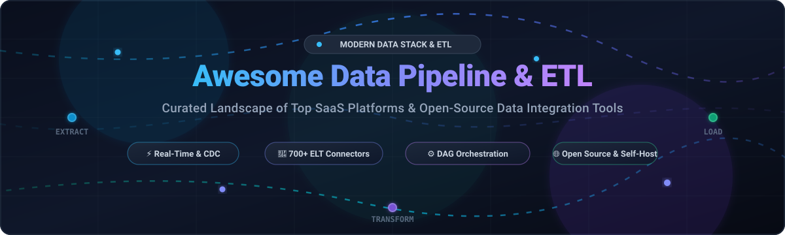

# ⚡ Awesome Data Pipeline & ETL 🚀

**Curated index of modern Data Pipelines, ETL / ELT platforms, stream processing engines, and workflow orchestrators.**

*Comprehensive guide for Data Engineers, Analytics Engineers, and MLOps Architects.*

---

## 📌 Overview & Architecture

Modern **Data Pipeline and ETL (Extract, Transform, Load)** infrastructure enables organizations to reliably ingest data across hundreds of disparate APIs and databases, transform it for low-latency analytics, and deliver clean data into modern lakehouses and cloud data warehouses.

Whether you are evaluating **fully-managed enterprise SaaS ELT solutions** or deploying **scalable self-hosted open-source orchestration engines**, this guide tracks leading technologies, market dynamics, transparent pricing, and repository popularity.

---

## 📑 Table of Contents

- [📊 Sector Overview & Market Dynamics](#-sector-overview--market-dynamics)
- [☁️ SaaS & Hosted ELT Platforms](#️-saas--hosted-elt-platforms)
- [🛠️ Open-Source GitHub Projects](#️-open-source-github-projects)
- [📈 Star History](#-star-history)
- [🤝 Support](#-support)
- [🤝 How to Contribute](#-how-to-contribute)
- [⚖️ Disclaimer](#️-disclaimer)

---

## 📊 Sector Overview & Market Dynamics

The global data pipeline and ETL tools market is estimated at approximately **$12B–$15B in 2025** (projected to reach **$35B–$48B by 2030** at ~20–26% CAGR), propelled by real-time event streaming, cloud data warehouse adoption, and AI/RAG ingestion demands.

The sector is **moderately to highly fragmented** rather than winner-take-all:
- **Cloud Giants & Legacy Integration:** Salesforce/MuleSoft, AWS Glue, Microsoft Azure Data Factory, and Google Cloud Dataflow maintain strong enterprise integration moats.
- **Modern ELT Specialization:** Dedicated SaaS vendors focus on zero-maintenance connectors, automated schema evolution, and flexible compute credits.
- **Open-Source Dominance:** Data engineering teams heavily leverage open-source workflows (Airflow, Kafka, Spark, Flink, dbt) to avoid vendor lock-in and retain sovereignty over private data pipelines.

---

## ☁️ SaaS & Hosted ELT Platforms

The following SaaS data pipeline solutions provide turnkey extract-load pipelines, pre-built API connectors, and automated schema drift handling. 

*Sorted in descending order by estimated company valuation/revenue:*

| Platform | Description | Company Size / Valuation | Starting Pricing | Free Tier / Trial Limits |
| :--- | :--- | :--- | :--- | :--- |
| **[Salesforce Data Pipelines](https://www.salesforce.com/)** | Salesforce-native integration service connecting external data sources with Data Prep recipes directly into Salesforce Data Cloud. | ~$290B+ Market Cap ($38B+ Rev) | $9,000/org/month (billed annually; requires Enterprise, Performance, or Unlimited editions) | No self-serve free tier/trial (Available via Salesforce Developer Edition org or custom Enterprise AE PoC) |
| **[Fivetran](https://www.fivetran.com/)** | Automated ELT platform with 700+ pre-built connectors and automated schema drift handling. | $5.6B Valuation (~$325M ARR) | $500/month (Starter tier; consumption based on Monthly Active Rows - MAR) | Free forever up to 500,000 MAR/month (or 14-day free trial with unlimited rows) |
| **[Airbyte Cloud](https://airbyte.com/)** | Cloud-managed edition of open-source Airbyte with 600+ connectors and hybrid data plane deployment. | $1.5B Valuation (~$18M–$20M ARR) | $15/month (Base Team tier; $2.50/credit consumption) | 30-day free trial with 400 free credits (valued at $2,000) |
| **[Matillion](https://www.matillion.com/)** | Cloud-native ELT platform with visual pipeline design and SQL pushdown execution inside the data warehouse. | $1.5B Valuation (~$90M–$100M ARR) | $2.00–$2.50/credit (Task-hour consumption; ~$20,000/year minimum commit for Teams) | Developer Tier (Free forever for 1 developer user; plus 14-day trial with 500 free credits) |
| **[Rivery](https://rivery.io/)** | All-in-one ELT platform with CDC capabilities, reverse ETL, and Python orchestration (acquired by Boomi). | ~$100M Acquired / $52M Raised (~$21M ARR) | $0.75–$0.90/credit (~$500/month for standard usage) | 14-day free trial with 1,000 free usage credits (no credit card required) |
| **[Stitch Data](https://www.stitchdata.com/)** | Developer-focused cloud ELT service built on the open Singer framework (part of Qlik Talend Cloud). | $60M Acquired ($30M+ Raised) | $100/month (Standard plan for up to 5M rows/month) | 14-day free trial with unlimited row syncing and all plan features |
| **[Hevo Data](https://hevodata.com/)** | Automated zero-maintenance ELT platform with 150+ connectors and auto-healing data pipelines. | $43M Raised (~$45M ARR) | $265–$299/month (Starter plan; scales from 5M events/month) | Free forever plan with up to 1 Million events/month (limited to free connectors, 5 users) |
| **[Estuary Flow](https://estuary.dev/)** | Real-time batch and streaming data pipeline platform offering sub-second latency with low-impact CDC. | $24M Raised (Series A) | $0.50/GB + $100/month per active connector instance | Free forever plan up to 10 GB/month data transfer and 2 active connector instances |
| **[Meltano](https://meltano.com/)** | Managed cloud infrastructure and orchestration for open-source Singer pipelines (GitLab spin-off). | $12.4M Raised (Seed) | Starter tier with 200 compute hours/month (~$150–$300/mo estimated usage) | Meltano Open is Free forever (Cloud requires contacting sales / 14-day pilot upon request) |
| **[Portable.io](https://portable.io/)** | Managed ETL specializing in long-tail obscure SaaS APIs and custom on-demand connector creation. | $3.24M Raised (Series A) | $1,800/month (Standard flat-rate unlimited volume plan) | 14-day free trial with unlimited connector testing and data syncing |

---

## 🛠️ Open-Source GitHub Projects

Leading open-source projects for data extraction, replication, change data capture (CDC), streaming, and workflow orchestration.

*Sorted in descending order by GitHub stargazer count:*

| Project | GitHub_Stars | Category & License | Description |
| :--- | :---: | :---: | :--- |
| **[n8n](https://github.com/n8n-io/n8n)** |  | Automation / Fair-code | Visual workflow automation platform with 400+ connectors for API-based data pipelines, lightweight ETL, and AI agent integrations. |
| **[Apache Airflow](https://github.com/apache/airflow)** |  | Orchestration / Apache-2.0 | Industry standard workflow orchestration platform using Python DAGs with a massive integration operator ecosystem. |
| **[Apache Spark](https://github.com/apache/spark)** |  | Engine / Apache-2.0 | Unified multi-language engine for large-scale distributed data processing, batch ETL, and real-time streaming analytics. |
| **[Apache Kafka](https://github.com/apache/kafka)** |  | Streaming / Apache-2.0 | High-throughput distributed event streaming platform powering mission-critical real-time ETL pipelines and Kafka Connect integrations. |
| **[Kestra](https://github.com/kestra-io/kestra)** |  | Orchestration / Apache-2.0 | Declarative event-driven orchestrator unifying data, AI, and microservices workflows via language-agnostic YAML configurations. |
| **[Apache Flink](https://github.com/apache/flink)** |  | Stream Processing / Apache-2.0 | Stateful stream processing framework for real-time low-latency ETL computations over unbounded and bounded data streams. |
| **[Prefect](https://github.com/PrefectHQ/prefect)** |  | Orchestration / Apache-2.0 | Modern Python-first workflow orchestrator enabling resilient data pipeline building, failure recovery, and hybrid execution. |
| **[Airbyte](https://github.com/airbytehq/airbyte)** |  | ELT Platform / Elastic-2.0 | Popular open-source ELT data integration engine with 600+ pre-built connectors syncing APIs and databases to warehouses. |
| **[Apache Arrow](https://github.com/apache/arrow)** |  | In-Memory Engine / Apache-2.0 | Cross-language development platform for columnar in-memory data, accelerating pipeline data interchange across modern systems. |
| **[Dagster](https://github.com/dagster-io/dagster)** |  | Orchestration / Apache-2.0 | Software-defined asset orchestrator with built-in data observability, testing frameworks, and type checking for data engineers. |
| **[Elastic Logstash](https://github.com/elastic/logstash)** |  | Ingestion / Apache-2.0 | Server-side data processing pipeline that ingests, filters, and transforms event and log data simultaneously from multiple sources. |
| **[Apache DolphinScheduler](https://github.com/apache/dolphinscheduler)** |  | Orchestration / Apache-2.0 | Distributed and extensible visual workflow scheduler dedicated to massive data pipeline task scheduling and cloud execution. |
| **[dbt Core](https://github.com/dbt-labs/dbt-core)** |  | Transformation / Apache-2.0 | The industry standard for in-warehouse ELT data transformations, software testing, version control, and data documentation. |
| **[Debezium](https://github.com/debezium/debezium)** |  | CDC / Apache-2.0 | Distributed Change Data Capture platform streaming row-level database changes into Kafka for low-latency real-time pipeline ingestion. |
| **[Apache SeaTunnel](https://github.com/apache/seatunnel)** |  | Integration / Apache-2.0 | High-performance distributed data integration engine supporting batch and real-time synchronization with 100+ connectors. |
| **[Apache Iceberg](https://github.com/apache/iceberg)** |  | Table Format / Apache-2.0 | High-performance open table format for huge analytic tables, bringing ACID transactions and schema evolution to data lakes. |
| **[Delta Lake](https://github.com/delta-io/delta)** |  | Table Format / Apache-2.0 | Open-source storage layer bringing ACID transactions, time travel, and scalable metadata handling to compute engines. |
| **[Mage](https://github.com/mage-ai/mage-ai)** |  | Pipeline Tool / Apache-2.0 | Open-source data pipeline platform enabling seamless integration, transformation, and orchestration with Python, SQL, and R. |
| **[Redpanda Connect (Benthos)](https://github.com/redpanda-data/connect)** |  | Stream Processing / Apache-2.0 | High-performance stream processor and declarative data pipeline tool with Bloblang mapping and 200+ connectors. |
| **[Apache Beam](https://github.com/apache/beam)** |  | Unified Pipeline / Apache-2.0 | Advanced unified programming model for batch and streaming pipelines running on Flink, Spark, or Google Cloud Dataflow. |
| **[CloudQuery](https://github.com/cloudquery/cloudquery)** |  | ELT Platform / MPL-2.0 | Open-source ELT framework extracting configurations, APIs, and cloud infrastructure data to databases and lakes as code. |
| **[Apache Camel](https://github.com/apache/camel)** |  | Enterprise Integration / Apache-2.0 | Enterprise integration framework providing hundreds of connectors, enterprise integration patterns (EIPs), and mediation rules. |
| **[Apache Hudi](https://github.com/apache/hudi)** |  | Lakehouse Storage / Apache-2.0 | Streaming data lakehouse platform managing storage with fast upserts, incremental data ingestion, and change streams. |
| **[Apache NiFi](https://github.com/apache/nifi)** |  | Flow Processing / Apache-2.0 | Mature visual data flow designer with fine-grained data provenance tracking, protocol routing, and system mediation. |
| **[dlt (data load tool)](https://github.com/dlt-hub/dlt)** | [?style=social&color=white](https://github.com/dlt-hub/dlt/stargazers) | Python Ingestion / Apache-2.0 | Python-first data loading library featuring automatic schema inference, nested JSON normalization, and AI code generation. |
| **[Meltano](https://github.com/meltano/meltano)** |  | DataOps ELT / MIT | Declarative, code-first ELT and DataOps platform orchestrating Singer taps/targets and dbt models with version control. |
| **[Elementary](https://github.com/elementary-data/elementary)** |  | Observability / Apache-2.0 | Open-source data observability and automated anomaly detection platform natively integrated with dbt pipelines. |
| **[Marquez](https://github.com/MarquezProject/marquez)** |  | Data Lineage / Apache-2.0 | Reference implementation of OpenLineage collecting and visualizing end-to-end data pipeline metadata and dependencies. |
| **[Bruin](https://github.com/bruin-data/bruin)** |  | Multi-language ETL / MIT | Fast CLI-driven pipeline tool enabling end-to-end data pipelines in SQL and Python with built-in asset dependencies and lineage. |
| **[Apache Hop](https://github.com/apache/hop)** |  | Visual ETL / Apache-2.0 | Metadata-driven visual data orchestration and transformation platform running pipelines across Spark, Flink, and Beam. |
| **[Singer Protocol](https://github.com/singer-io/getting-started)** |  | Open Specification / Apache-2.0 | Composable specification and standard for moving data between sources (taps) and destinations (targets) via UNIX pipes. |

---

## 📈 Star History

---

## 💖 Support

Thank you for exploring this curated guide! 🌟 If this repository helps you build, scale, or evaluate your data stack:

- ⭐ **Star this repository** to help others discover it!
- 🍴 **Fork the repo** to contribute your own favorite tools or architecture templates.
- 📢 **Share** with your fellow data engineers and analytics teams.
- ☕ **Support development:** If you'd like to support the maintenance of this and other open-source resources, consider sponsoring via the **[GitHub Sponsor Dashboard](https://github.com/sponsors/ishandutta2007)**.

---

## 🤝 How to Contribute

Contributions are always welcome! 🚀

1. 🍴 Fork the repository.
2. 🌿 Create a descriptive branch (`git checkout -b add-awesome-tool`).
3. 📝 Add or update tools in `README.md` following the established table structure.
4. 🔍 Keep descriptions concise, factual, and include official documentation links.
5. 🚀 Open a Pull Request with a clear summary of your additions.

---

## ⚖️ Disclaimer

- This is a community-curated directory intended for research and educational purposes — not a commercial endorsement.
- Ensure all pipeline infrastructure complies with applicable regional data security standards (GDPR, CCPA, SOC2, HIPAA).
- Self-hosted open-source software requires operational infrastructure provisioning, cluster maintenance, and security monitoring.

---

**Built for data engineers, analytics engineers, and developers shaping the modern data landscape.**  
*Let's build more reliable, observable, and scalable data pipelines.*

